<div align="center">

<h1>Automatic Reproducible Camera Intrinsic Calibration</h1>

<p><a href="https://github.com/JokerJohn"><b>Xiangcheng Hu</b></a></p>

<p><a href="README.md"><b>English</b></a> | <a href="README.zh.md">中文</a></p>

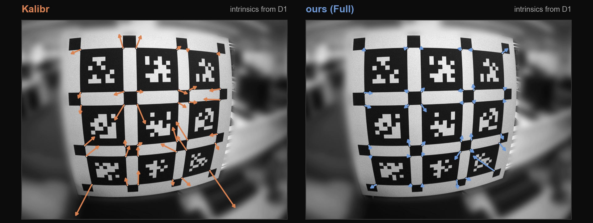

<a href="https://arxiv.org/abs/2609.10082"></a><a></a><a href="./README/intrinsic_calib_video.mp4"></a><a></a>[](https://github.com/JokerJohn/IntrinsicCalib/stargazers)<a href="https://github.com/JokerJohn/IntrinsicCalib/network/members"></a>[](https://github.com/JokerJohn/IntrinsicCalib/issues)[](./LICENSE)

</div>

## Introduction

Accurate camera intrinsic calibration depends on the quality of the collected images, yet existing target-based methods often require the practitioner to select high-quality images and to specify the radial distortion order manually. This work determines both from the collected data.

**Key insight: the two decisions are coupled through the residual.** A higher-order model lowers the residual scale that defines the rejection threshold, and the calibration-set residual cannot validate the added coefficient. Image rejection therefore runs under each candidate order, and the order is selected on held-out images with the intrinsics and distortion fixed.

- **Intrinsic calibration method.** An automatic and operator-free method iteratively selects high-quality images and the distortion order, yielding accurate and reproducible intrinsics.
- **Distortion-order selection.** A criterion evaluates each candidate on held-out images with the intrinsics and distortion fixed, avoiding the use of calibration-set residuals to assess model adequacy.
- **Interactive calibration tool.** An open-source tool for chessboard and AprilGrid targets, validated on public datasets and real-world robots.

| 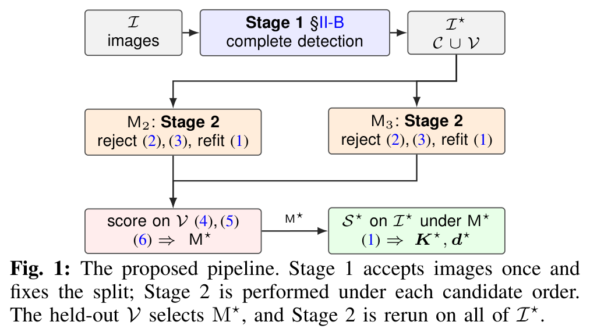 | 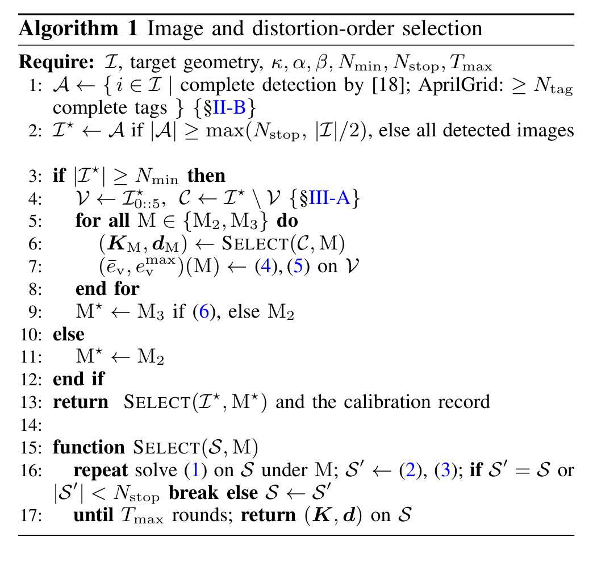 |
| ------------------------------------------------------------ | ------------------------------------------------------------ |

## News

- **2026/11**: The paper has been accepted by IEEE Robotics and Automation Practice (RA-P).
- **2026/10/11**: The calibration tool, data and experiment scripts are released.
- **2026/09/09**: The paper is available on [arXiv](https://arxiv.org/abs/2609.10082).

## Video

<div align="center">

<a href="./README/intrinsic_calib_video.mp4">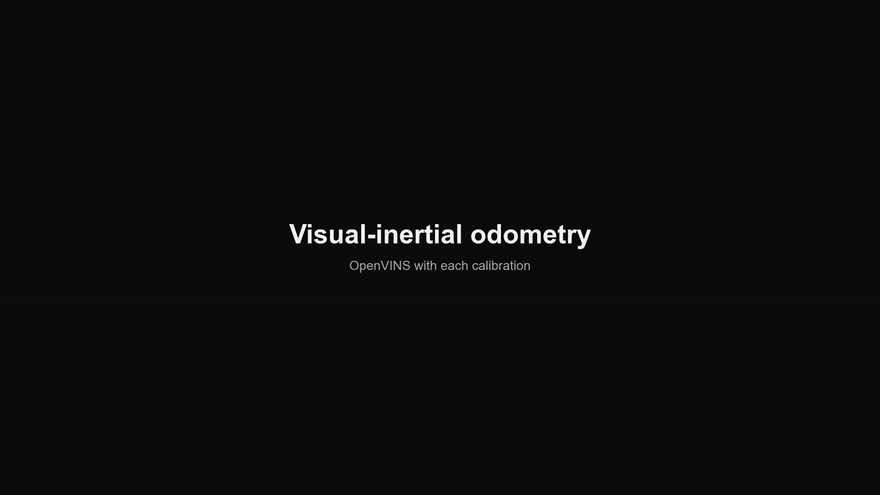</a>

</div>

Click the image to play the full video (92 s).

## Method

**Image selection.** Stage 1 admits an image only if the extractor recovers the complete inner-corner grid. Stage 2 iteratively rejects the images whose mean residual exceeds a multiple of the median and re-solves the calibration:

<div align="center">

$$
\tau^{(t)} = \kappa\,\tilde{e}^{(t)}, \qquad
\mathcal{I}^{(t+1)} = \lbrace\, i\in\mathcal{I}^{(t)} \mid \bar{e}_i^{(t)} \le \tau^{(t)} \,\rbrace
$$

</div>

**Distortion-order selection.** The accepted set is split into an estimation subset and a validation subset $\mathcal{V}$. Each candidate is estimated with Stage 2 applied internally, and only the board pose is re-estimated on $\mathcal{V}$. $\mathrm{M}_3$ (adds $k_3$ to $\mathrm{M}_2$) is adopted if and only if it degrades neither the mean nor the worst-view error:

<div align="center">

$$
\bar{e}_{\mathrm{v}}(\mathrm{M}_3) \le \alpha\,\bar{e}_{\mathrm{v}}(\mathrm{M}_2)
\quad\text{and}\quad
e^{\max}_{\mathrm{v}}(\mathrm{M}_3) \le \beta\,e^{\max}_{\mathrm{v}}(\mathrm{M}_2)
$$

</div>

All hyper-parameters are fixed across every dataset: $\kappa=2$, $\alpha=\beta=1$, $N_{\min}=15$, $N_{\mathrm{stop}}=8$, $T_{\max}=3$.

**Interactive tool.** The tool displays the filtering status of every image and the distribution of calibration points, and records every decision. Left: a chessboard session (Rig-A, played at 3x). Right: an AprilGrid session (Rig-C).

| 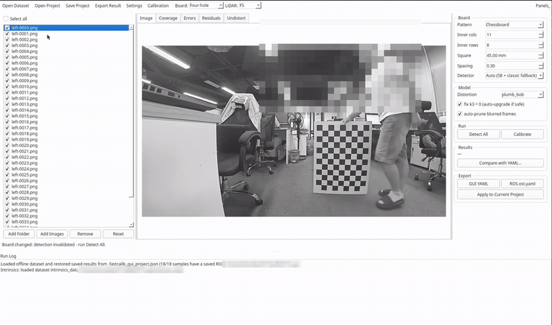 | 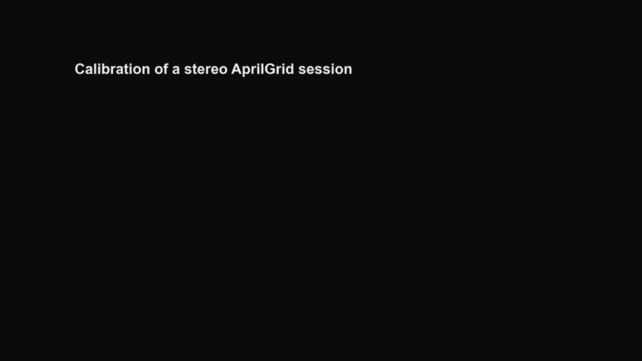 |
| ------------------------------------------------------------ | ------------------------------------------------------------ |

## Datasets

<div align="center">

| Dataset | Camera | Target | Data |
| ------- | ------ | ------ | ---- |
| `Rig-A` | 1920 x 1080, 111° | chessboard 11 x 8, 45 mm | 39 images |
| `Rig-B` | second camera of the same model | chessboard 11 x 8, 45 mm | 64 images |
| `Rig-C` | handheld stereo FLIR, 1440 x 1080, 113° | 3 x 3 AprilGrid | sessions D1, D2; sequences S1, S2, S3 |
| `Rig-D` | wheeled robot, Rig-A camera model | chessboard 11 x 8, 45 mm | one 163 s sequence |
| `Public` | OpenCalib, ROS, OpenCV | chessboard | five sessions |

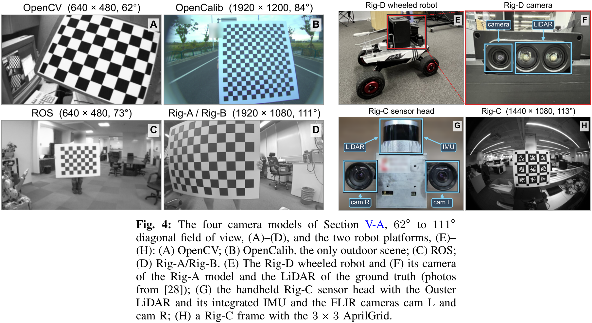

</div>

Rig-A and Rig-B ship in `data/`. The Rig-C and Rig-D bags are available from [Baidu Netdisk](https://pan.baidu.com/s/1n3tDlzshlr6OiQmL6GJtyQ?pwd=vihg) (code `vihg`), and the public sessions are fetched from their original sources. [docs/DATA.md](./docs/DATA.md) lists the data of every experiment.

## Results

**Image and order selection.** On Rig-A, the two stages reduce the held-out error from 0.419 to 0.316 px (25%). $\mathrm{M}_3$ further reduces the held-out mean to 0.299 px and the worst view from 0.590 to 0.554 px.

| 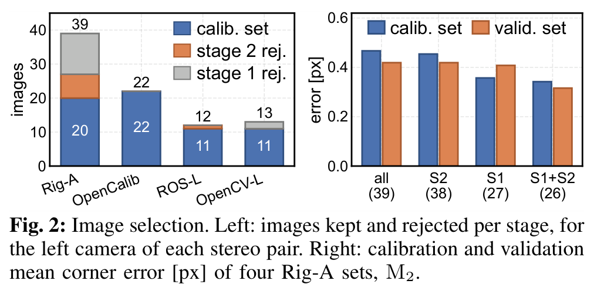 | 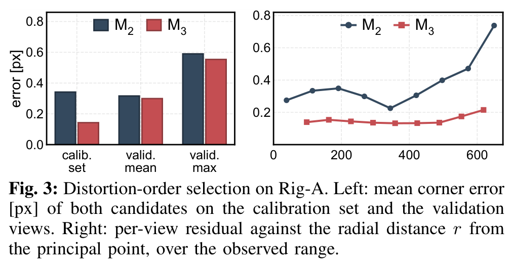 |
| ------------------------------------------------------------ | ------------------------------------------------------------ |

**Cross-session consistency.** On Rig-C, the method reduces the cross-session error of Kalibr by 36 to 50% on both cameras. The focal length varies by less than 1.5 px between the days, against about 7 px for Kalibr.

| 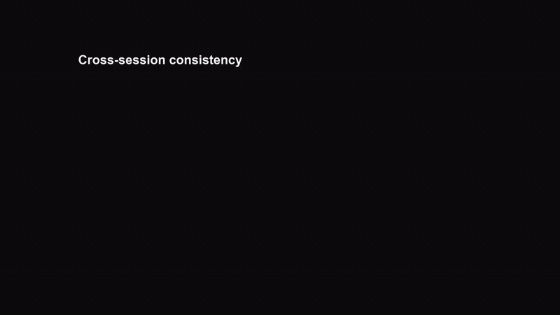 | 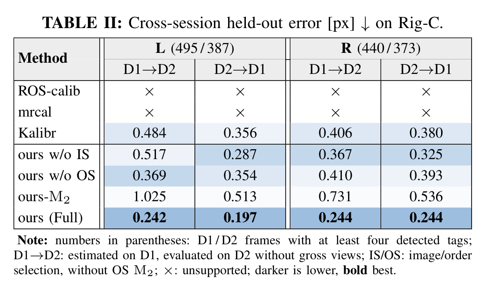 |
| ------------------------------------------------------------ | ------------------------------------------------------------ |

**Public sessions and odometry.** The pipeline achieves the lowest held-out mean on all five public sessions. With OpenVINS, the intrinsics yield the lowest trajectory error on all three Rig-C sequences and the lowest median error on Rig-D.

| 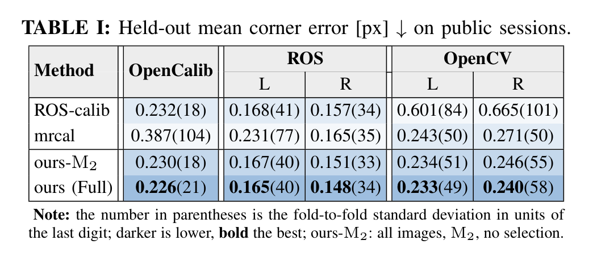 | 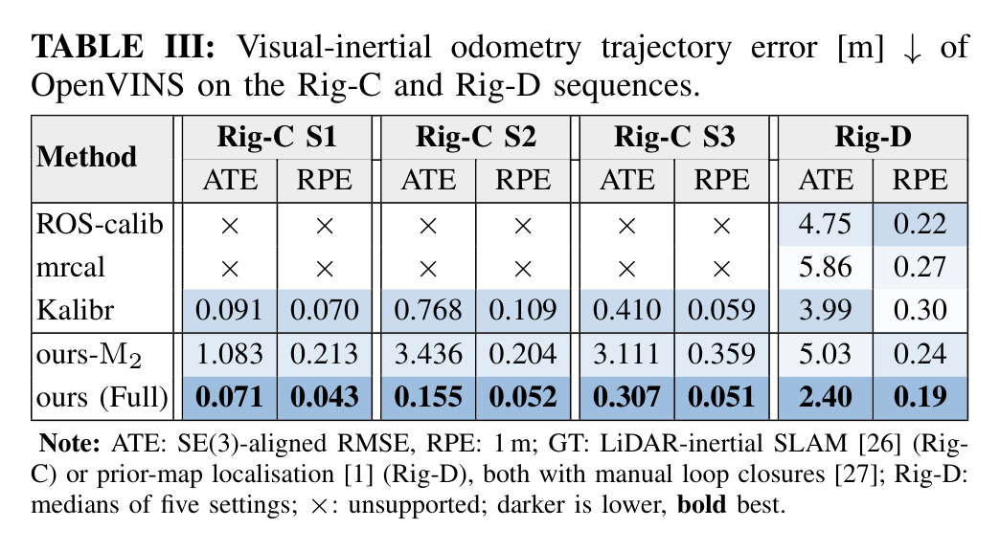 |
| ------------------------------------------------------------ | ------------------------------------------------------------ |

## Getting Started

The implementation uses Python 3.10, OpenCV 4.13 and PySide6, and has been tested on Ubuntu 20.04.

```bash
git clone https://github.com/JokerJohn/IntrinsicCalib.git && cd IntrinsicCalib
conda create -n intrinsic_calib python=3.10 && conda activate intrinsic_calib
pip install -r requirements.txt
sudo apt install g++ pkg-config libopencv-dev libeigen3-dev   # Kalibr extractors, compiled on first use

python tool/run_intrinsics_gui.py data/rig_a                  # interactive tool: Detect All, then Calibrate
python experiments/public/experiment/rap_headless.py data/rig_a --out rig_a.json   # headless
```

The headless run returns 39 detected, 27 after Stage 1, 20 final, $\mathrm{M}_3$ and 0.143 px on the retained images. [docs/REPRODUCE.md](./docs/REPRODUCE.md) describes the Python interface, the commands that reproduce every table of the paper and the tests.

```
tool/          calibration package intrinsic_calib and the launcher
experiments/   public (Table I), rigc (Table II), vio (Table III)
data/          Rig-A, Rig-B, Rig-C Kalibr files, manifest of the bags
tests/         tests of the Rig-A selection, the AprilGrid extraction and the tool
```

## TODO

- [x] Release the calibration tool and the experiment scripts
- [x] Release the Rig-A to Rig-D data
- [ ] Add rational and fisheye candidate models
- [ ] Add coverage constraints
- [ ] Support rolling-shutter and event cameras

## Citation

```bibtex
@article{hu2026intrinsiccalib,
  title         = {Automatic Reproducible Camera Intrinsic Calibration},
  author        = {Hu, Xiangcheng},
  journal       = {IEEE Robotics and Automation Practice},
  note          = {Accepted},
  eprint        = {2609.10082},
  archivePrefix = {arXiv},
  primaryClass  = {cs.RO},
  year          = {2026}
}
```

Related work: [P²Calib](https://github.com/JokerJohn/P2Calib) and [VeriCalib](https://github.com/JokerJohn/VeriCalib).

## Acknowledgment

The tool uses [OpenCV](https://github.com/opencv/opencv) and the `ethz_apriltag2` decoder of [Kalibr](https://github.com/ethz-asl/kalibr). The evaluation uses the data and baselines of [OpenCalib](https://github.com/PJLab-ADG/SensorsCalibration), [ROS camera_calibration](http://wiki.ros.org/camera_calibration), [mrcal](https://mrcal.secretsauce.net) and Kalibr. The odometry experiments and the ground truth use [OpenVINS](https://github.com/rpng/open_vins), [evo](https://github.com/MichaelGrupp/evo), [FAST-LIO2](https://github.com/hku-mars/FAST_LIO), [PALoc](https://github.com/JokerJohn/PALoc) and [Manual Loop Closure Tools](https://github.com/JokerJohn/Mannual-Loop-Closure-Tools).

## License

Released under the [MIT license](./LICENSE). `tool/intrinsic_calib/kalibr_extractor/third_party/` contains the `ethz_apriltag2` sources and the target-extractor code of Kalibr (BSD, [KALIBR_LICENSE](tool/intrinsic_calib/kalibr_extractor/third_party/KALIBR_LICENSE)). The public sessions keep the licences of their sources.

## Contributors

<a href="https://github.com/JokerJohn/IntrinsicCalib/graphs/contributors">
  
</a>
