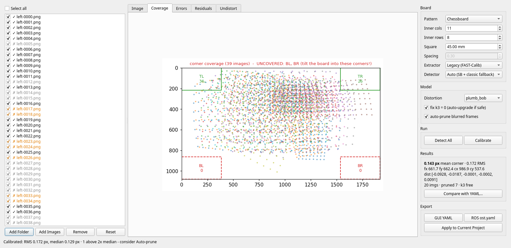
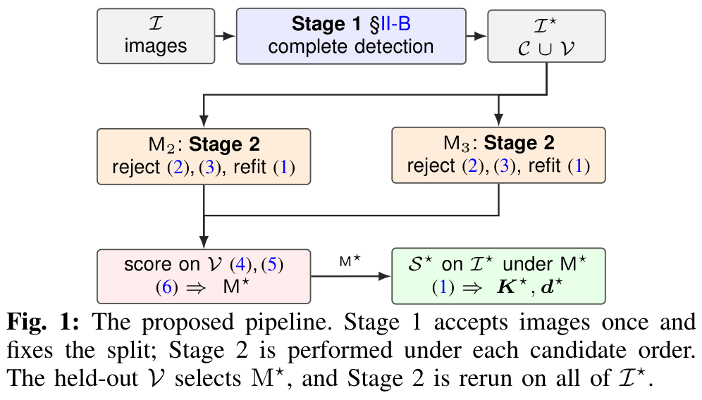
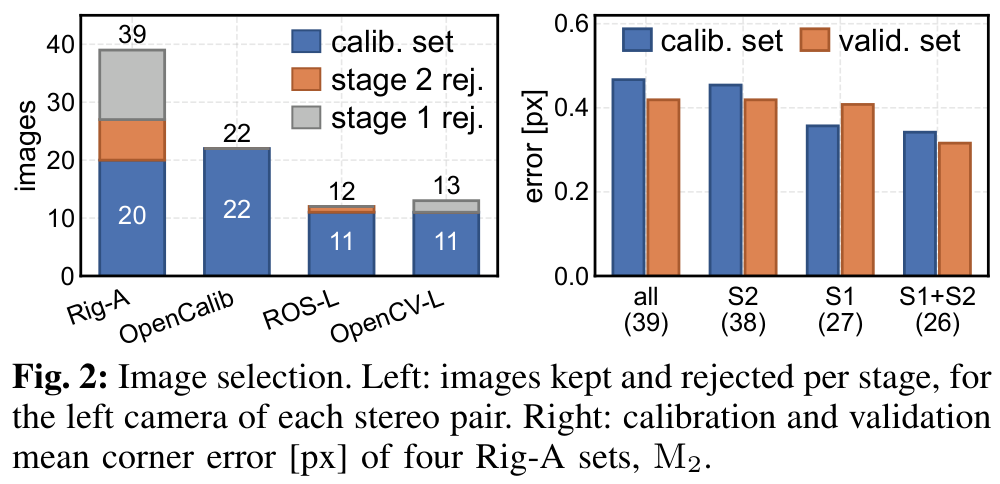
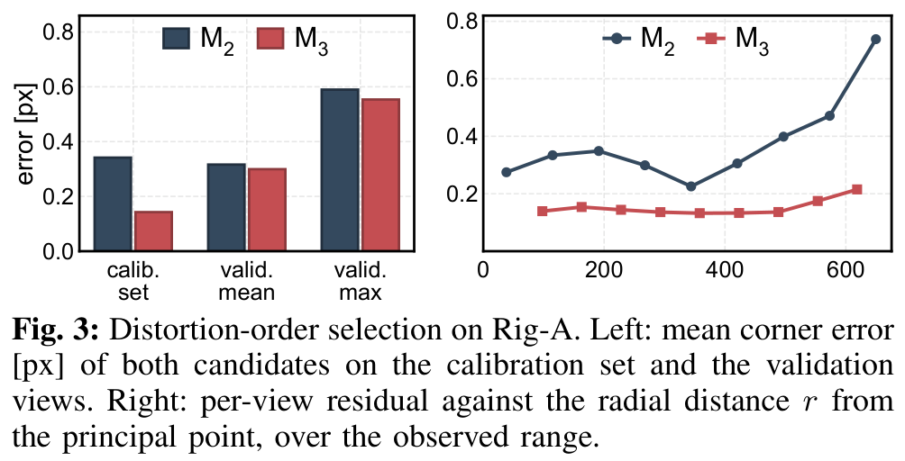
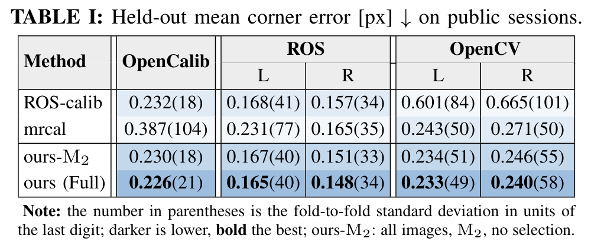
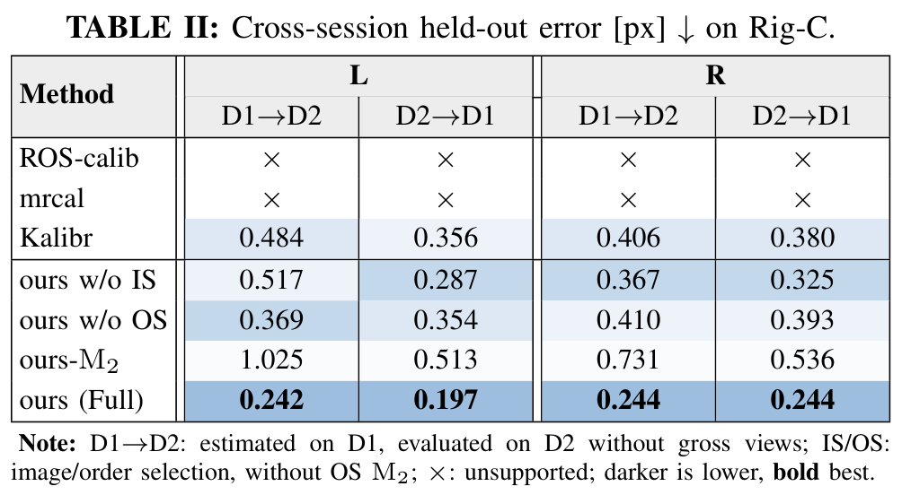
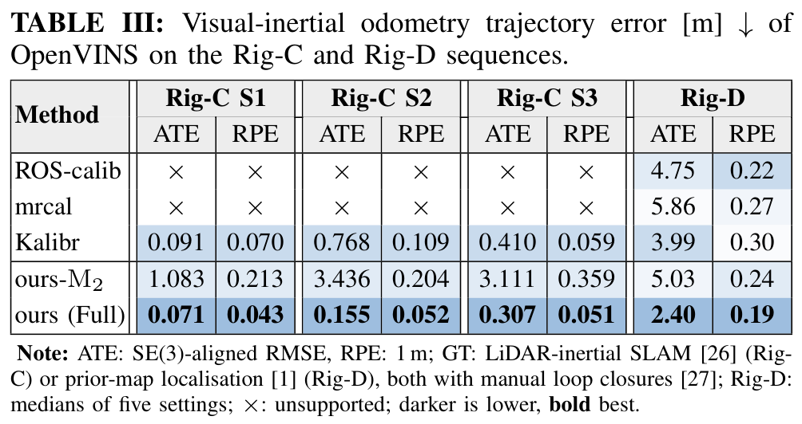
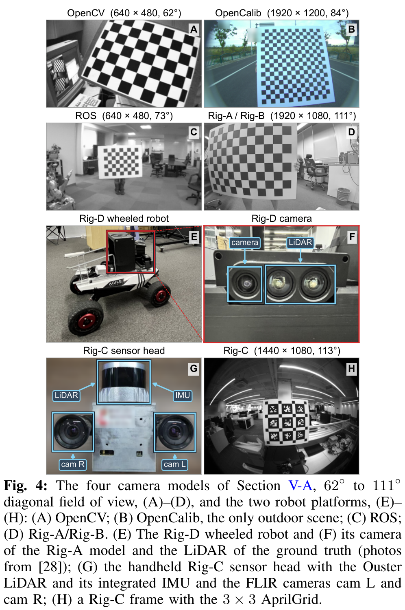

<div align="center">

<h1>Automatic Reproducible Camera Intrinsic Calibration</h1>

<p><a href="https://github.com/JokerJohn"><b>Xiangcheng Hu</b></a></p>



<a href="https://arxiv.org/abs/2609.10082"></a><a></a>[](https://github.com/JokerJohn/IntrinsicCalib/stargazers)<a href="https://github.com/JokerJohn/IntrinsicCalib/network/members"></a>[](https://github.com/JokerJohn/IntrinsicCalib/issues)[](https://opensource.org/licenses/MIT)

</div>

## Introduction

Accurate camera intrinsic calibration is fundamental to robot perception, and the accuracy depends on the quality of the collected images. Existing target-based calibration methods often require the practitioner to manually select high-quality images and to specify an appropriate radial distortion order. This repository contains an automatic intrinsic calibration pipeline that determines both from the collected data, together with the data and the scripts of every experiment of the paper.

The contributions are threefold:

- **Intrinsic calibration method.** An automatic and operator-free method that iteratively selects high-quality images and the distortion order, yielding accurate and reproducible intrinsics. An iterative rejection scheme estimates the parameters on a candidate image set and removes views whose mean residual exceeds a multiple of the median. This process runs independently under each candidate distortion order, so that the retained image set is consistent with the residual scale of that order.
- **Distortion-order selection.** A criterion that evaluates each candidate within the selected images on held-out images, with the intrinsics and distortion fixed and only the board pose re-estimated, so that an added coefficient is supported by independent observations.
- **Interactive calibration tool.** An open-source tool for chessboard and AprilGrid targets that supports full-pipeline data inspection and parameter estimation.

Experiments on public datasets and two robot platforms show that the method reduces the held-out reprojection error by up to 25% over calibration without image selection, keeps the focal length consistent within 0.3% across sessions, and reduces the visual-inertial odometry error by up to 80% compared with popular baselines.

<div align="center">



</div>

## News

- **2026/10**: code, data and experiment scripts released.
- **2026/09/09**: [arXiv preprint](https://arxiv.org/abs/2609.10082) online; code, tool and data are being prepared for release.

## Method

Calibration over an image set $\mathcal{S}$ estimates the intrinsics $K$, the distortion $d$ and one board pose $T_i$ per image:

<div align="center">

$$
\min_{K,\,d,\,\lbrace T_i\rbrace}
\sum_{i \in \mathcal{S}} \sum_{j=1}^{N_i}
\left\| u_{ij} - \pi(K, d, T_i, P_j) \right\|_2^2
$$

</div>

**Stage 1** admits an image only if the corner extractor recovers the complete inner-corner grid; for partially visible AprilGrid targets, a corner is accepted only if its saddle-point refinement converges within a maximum shift of the detected position, and a frame only if it contains enough complete tags. **Stage 2** rejects the images whose mean residual exceeds a multiple of the median of the retained set and re-solves the calibration:

<div align="center">

$$
\tau^{(t)} = \kappa\,\tilde{e}^{(t)},
\qquad
\mathcal{I}^{(t+1)} = \left\lbrace i \in \mathcal{I}^{(t)} \;\middle|\; \bar{e}_i^{(t)} \le \tau^{(t)} \right\rbrace
$$

</div>

**Distortion-order selection.** The accepted set is split into an estimation subset $\mathcal{C}$ and a validation subset $\mathcal{V}$ by assigning every fifth image in capture order to $\mathcal{V}$. Each candidate order (M2: $k_1, k_2, p_1, p_2$; M3: additionally $k_3$) is estimated on $\mathcal{C}$ with Stage 2 applied internally; on each validation image the intrinsics and distortion are fixed and only the board pose is re-estimated:

<div align="center">

$$
\hat{T}_i^{\mathrm{M}} = \arg\min_{T \in \mathrm{SE}(3)}
\sum_{j=1}^{N_i}
\left\| u_{ij} - \pi(K_{\mathrm{M}}, d_{\mathrm{M}}, T, P_j) \right\|_2^2
$$

</div>

M3 is adopted if and only if it degrades neither the mean nor the worst-case validation error:

<div align="center">

$$
\bar{e}_{\mathrm{v}}(\mathrm{M}_3) \le \alpha\,\bar{e}_{\mathrm{v}}(\mathrm{M}_2)
\quad\text{and}\quad
e^{\max}_{\mathrm{v}}(\mathrm{M}_3) \le \beta\,e^{\max}_{\mathrm{v}}(\mathrm{M}_2)
$$

</div>

Stage 2 is then rerun on the full accepted set under the selected order. All hyper-parameters are fixed across every dataset: $\kappa=2$, $\alpha=\beta=1$, $N_{\min}=15$, $N_{\mathrm{stop}}=8$, $T_{\max}=3$.

<div align="center">



</div>

<div align="center">



</div>

## Installation

The implementation is in Python 3.10 and has been tested on Ubuntu 20.04.

```bash
git clone https://github.com/JokerJohn/IntrinsicCalib.git
cd IntrinsicCalib
conda create -n intrinsic_calib python=3.10 && conda activate intrinsic_calib
pip install -r requirements.txt
# Kalibr AprilGrid and checkerboard extractors (compiled on first use)
sudo apt install g++ pkg-config libopencv-dev libeigen3-dev
```

The following components are required only by the baselines and experiments that name them:

| component | used by |
|---|---|
| ROS Noetic with `camera_calibration` (`/usr/bin/python3`) | ROS-calib baseline, Table I |
| mrcal (`sudo apt install mrcal`) | mrcal baseline, Table I |
| evo (`evo_ape`, `evo_rpe`) | Table III |
| ROS Noetic, OpenVINS, FAST-LIVO2, VINS-Fusion | rerunning the VIO experiments ([experiments/vio/README.md](experiments/vio/README.md)) |
| Docker image of Kalibr | Kalibr runs ([experiments/public/extra/kalibr_baseline/README.md](experiments/public/extra/kalibr_baseline/README.md)) |

Every script resolves the tool and the data relative to the repository. The following environment variables override the defaults:

| variable | meaning | default |
|---|---|---|
| `CALIB_TOOL_DIR` | directory that contains `fast_calib_offline_gui/` | `tool/` |
| `RIG_A_DIR`, `RIG_B_DIR` | Rig-A and Rig-B image folders | `data/rig_a`, `data/rig_b` |
| `PUBLIC_DIR` | directory of the fetched public sessions | `experiments/public` |
| `RIGC_DIR` | directory of the Rig-C and Rig-D bags ([data/rigc/MANIFEST.md](data/rigc/MANIFEST.md)) | `data/rigc` |
| `FASTLIVO_WS`, `VIO_WS` | catkin workspaces of FAST-LIVO2 and of OpenVINS and VINS-Fusion | required by the VIO scripts |
| `EVO_BIN` | directory of `evo_ape` and `evo_rpe` | `~/.local/bin` |
| `KALIBR_IMAGE` | Docker image that runs `kalibr_calibrate_cameras` | `kalibr:noetic` |
| `OPENCV_HAARCASCADES` | Haar cascades used to blur faces in the figures | `cv2.data` |

## Quick Start

### Interactive tool

```bash
python tool/run_intrinsics_gui.py data/rig_a
```

The window opens the Rig-A session; `data/rig_a/.fastcalib_intrinsics.json` holds the board specification (11 x 8 inner corners, 45 mm). `Detect All` runs the corner extraction and `Calibrate` runs the two selection stages and the order selection. The tool displays the filtering status of every image and the distribution of the calibration points, and records the images retained and rejected at each stage with their residuals, the subsets $\mathcal{C}$ and $\mathcal{V}$, the four quantities of the order criterion, the selected order and the corner-zone counts. `GUI YAML` and `ROS ost.yaml` export the parameters. Any other folder of chessboard or AprilGrid images is opened with `Add Folder`; `experiments/public/make_gui_session.py <folder> --cols C --rows R --square-mm S` writes the session file for it.

### Headless

The algorithmic core is independent of the interface. `rap_headless.py` executes the orchestration of the `Calibrate` action without Qt:

```bash
python experiments/public/experiment/rap_headless.py data/rig_a --out rig_a.json
# RAP  data/rig_a: 39 detected -> stage1 27 -> final 20 | M3 (free k3) | in-sample mean corner 0.143 px
```

The same functions are available from Python:

```python
import sys
sys.path[:0] = ["tool", "experiments/public/experiment"]
from fast_calib_offline_gui.camera_intrinsics import BoardSpec, result_to_ost_yaml
from rap_headless import detect_all, run_rap

spec = BoardSpec(pattern="chessboard", cols=11, rows=8, square_mm=45.0)
entries, size = detect_all("data/rig_a", spec)     # corner extraction (detect_corners_ex)
res = run_rap(entries, spec, size)                 # Stage 1, Stage 2, order selection, final fit (calibrate)
print(res["trace"]["order"]["chosen"])             # M3 (free k3)
print(res["K"], res["dist"])                       # fx = 661.73 px
ost = result_to_ost_yaml(res, "rig_a")             # ROS camera_info layout
```

`res["trace"]` lists the images rejected by Stage 1 and Stage 2, the validation subset and the validation errors of both orders. For an AprilGrid target, `BoardSpec(pattern="aprilgrid", cols=3, rows=3, square_mm=115.0, tag_spacing=0.3)` selects the Kalibr tag decoder with saddle-point refinement.

## Reproducing the Paper

| item | command | expected output |
|---|---|---|
| Rig-A numbers (Section V-B, V-C) | `python experiments/public/experiment/rap_headless.py data/rig_a --out rig_a.json` | Stage 1 rejects 12 of 39, Stage 2 rejects 7, M3 selected (validation mean 0.316 to 0.299 px, max 0.590 to 0.554 px), 0.143 px on the retained images |
| Table I | `cd experiments/public && ./fetch_datasets.sh && ./write_sessions.sh && cd experiment && python final_comparison.py ../opencalib_front ../ros_wide_left ../ros_wide_right ../opencv_left ../opencv_right --every 4 --json-out out/final_table.json` | column `cell` of the printout ([experiments/public/README.md](experiments/public/README.md)) |
| Table II | `cd experiments/rigc && python flir_full.py cam0 && python flir_full.py cam1 && python ablation_rigc.py` | the printed table ([experiments/rigc/README.md](experiments/rigc/README.md)); uses the shipped corner caches, no bags required |
| Table III | `cd experiments/vio && python make_table3.py` | the printed table ([experiments/vio/README.md](experiments/vio/README.md)); scores the shipped OpenVINS trajectories against the ground truth |
| Table III, VIO runs | `experiments/vio/run_matrix_all.sh` (Rig-C), `experiments/vio/rigd/run_rigd.py`, `run_rigd_variants.py` (Rig-D) | trajectories of `experiments/vio/results/trajectories/`; bags, ROS and the VIO workspaces required |
| Fig. 2, Fig. 3 | `python figures/make_fig2_selection.py`, `python figures/make_fig3_order.py` | `figures/out/fig_select2.pdf`, `figures/out/fig_order.pdf` |
| Fig. 4 (supplement) | `PUBLIC_DIR=experiments/public python figures/make_fig4_datasets.py` | `figures/out/fig_datasets.pdf` (after `fetch_datasets.sh`) |
| Consistency with the ROS calibrator (supplement) | `python experiments/public/experiment/rig_ab_ros_check.py` | parameter differences on Rig-A and Rig-B |

Fig. 1 is drawn in TikZ in the manuscript. The determinism of the pipeline relies on single-threaded numerics; the commands above are run with `OMP_NUM_THREADS=1`.

<div align="center">



</div>

<div align="center">



</div>

<div align="center">



</div>

## Data

<div align="center">



</div>

| directory | content |
|---|---|
| `data/rig_a/` | Rig-A: 39 images, 1920 x 1080, 11 x 8 inner corners, 45 mm squares, with the session file and the `ost.yaml` of the ROS calibrator |
| `data/rig_b/` | Rig-B: 64 images of a second camera of the same model, with the session file and `ost.yaml` |
| `data/rigc/kalibr_D1/`, `data/rigc/kalibr_D2/` | Kalibr input and output of the two Rig-C calibration sessions (camera chain, camera-IMU calibration) |
| `data/rigc/frames/` | one Rig-C frame (session D2, cam0) |
| `experiments/rigc/corners_*.json` | corner observations of all Rig-C calibration frames |
| `experiments/vio/gt/` | ground truth of the VIO sequences: FAST-LIO2 with manual loop closures (Rig-C), PALoc prior-map localisation with manual loop closures (Rig-D) |
| `experiments/vio/results/trajectories/` | OpenVINS trajectories of Table III |

The five public sessions are fetched from their original sources by `experiments/public/fetch_datasets.sh`. The Rig-C bags (two calibration sessions and three VIO sequences, 21 GB) and the Rig-D bag (one 163 s sequence, 11 GB) are hosted separately; [data/rigc/MANIFEST.md](data/rigc/MANIFEST.md) lists their file names, sizes, checksums, durations and topics. Download link: to be added.

## Repository Structure

```
tool/                    calibration package fast_calib_offline_gui and the launcher run_intrinsics_gui.py
experiments/public/      Table I: fetch script of the public sessions, protocol, ROS-calib and mrcal baselines
experiments/rigc/        Table II: cross-session evaluation and IS/OS ablation on Rig-C, intrinsics of every method
experiments/vio/         Table III: OpenVINS configurations, run scripts, evo evaluation, ground truth
figures/                 one script per paper figure and their inputs
data/                    Rig-A, Rig-B, Rig-C Kalibr files, manifest of the bags
tests/                   smoke tests
```

## Tests

```bash
pip install pytest
OMP_NUM_THREADS=1 QT_QPA_PLATFORM=offscreen python -m pytest tests -q
```

The tests run in less than one minute without a display. `test_rig_a.py` calibrates `data/rig_a` with the default settings and checks the selected order (M3), the rejections of Stage 1 (12 of 39) and Stage 2 (7), the validation errors of both orders and the calibration-set mean corner error (0.143 px), and that two runs return identical intrinsics. `test_aprilgrid.py` extracts the AprilGrid corners of the shipped Rig-C frame and compares them with the corner cache of Table II. `test_gui.py` renders the tool offscreen, detects and calibrates Rig-A, and checks the selection.

## Citation

```bibtex
@article{hu2026intrinsiccalib,
  title   = {Automatic Reproducible Camera Intrinsic Calibration},
  author  = {Hu, Xiangcheng},
  journal = {arXiv preprint arXiv:2609.10082},
  eprint  = {2609.10082},
  year    = {2026}
}
```

## License

Released under the [MIT license](./LICENSE). `tool/fast_calib_offline_gui/kalibr_extractor/third_party/` contains the `ethz_apriltag2` sources and the target-extractor code of Kalibr (BSD, [KALIBR_LICENSE](tool/fast_calib_offline_gui/kalibr_extractor/third_party/KALIBR_LICENSE)). The public sessions keep the licences of their sources ([experiments/public/README.md](experiments/public/README.md)).

## Acknowledgements

The tool uses [OpenCV](https://github.com/opencv/opencv) and the `ethz_apriltag2` decoder of [Kalibr](https://github.com/ethz-asl/kalibr). The evaluation uses the public data and baselines of [OpenCalib](https://github.com/PJLab-ADG/SensorsCalibration), [ROS camera_calibration](http://wiki.ros.org/camera_calibration), [OpenCV](https://github.com/opencv/opencv), [mrcal](https://mrcal.secretsauce.net) and [Kalibr](https://github.com/ethz-asl/kalibr), and [OpenVINS](https://github.com/rpng/open_vins), [evo](https://github.com/MichaelGrupp/evo), [FAST-LIO2](https://github.com/hku-mars/FAST_LIO) and [PALoc](https://github.com/JokerJohn/PALoc) for the odometry experiments and the ground truth.

## Contributors

<a href="https://github.com/JokerJohn/IntrinsicCalib/graphs/contributors">
  
</a>
