<div align="center">

<h1>Automatic Reproducible Camera Intrinsic Calibration</h1>

<p><a href="https://github.com/JokerJohn"><b>Xiangcheng Hu</b></a></p>

<p><a href="README.md">English</a> | <a href="README.zh.md"><b>中文</b></a></p>

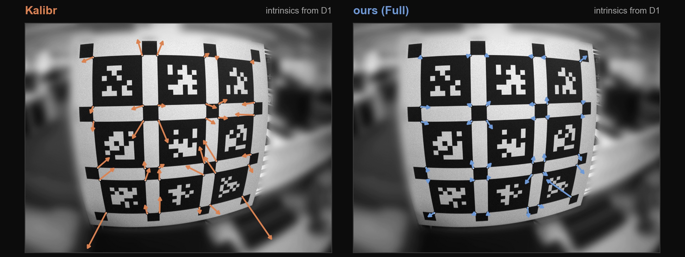

<a href="https://arxiv.org/abs/2609.10082"></a><a></a><a href="./README/intrinsic_calib_video.mp4"></a><a></a>[](https://github.com/JokerJohn/IntrinsicCalib/stargazers)<a href="https://github.com/JokerJohn/IntrinsicCalib/network/members"></a>[](https://github.com/JokerJohn/IntrinsicCalib/issues)[](./LICENSE)

</div>

## 简介

相机内参标定的精度取决于所采集图像的质量，而现有基于标定板的方法通常要求使用者手动筛选高质量图像并指定径向畸变阶数。本文从采集数据中自动确定这两项输入。

**核心思想：两项决策通过残差相互耦合。** 高阶模型会降低用于定义剔除阈值的残差尺度，而标定集残差无法验证新增系数。因此，图像剔除在每个候选阶数下独立执行，畸变阶数则在内参与畸变系数固定的条件下，由留出图像确定。

- **内参标定方法。** 提出一种自动且无需人工干预的方法，迭代地选择高质量图像与畸变阶数，得到准确且可复现的内参。
- **畸变阶数选择。** 提出一种选择准则，在内参与畸变系数固定的条件下于留出图像上评估各候选阶数，避免以标定集残差判断模型是否充分。
- **交互式标定工具。** 开发面向棋盘格与 AprilGrid 标定板的开源工具，并在公开数据集和真实机器人上完成验证。

| 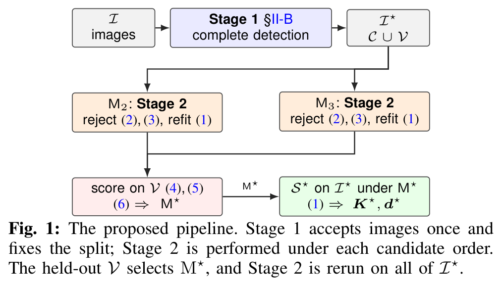 | 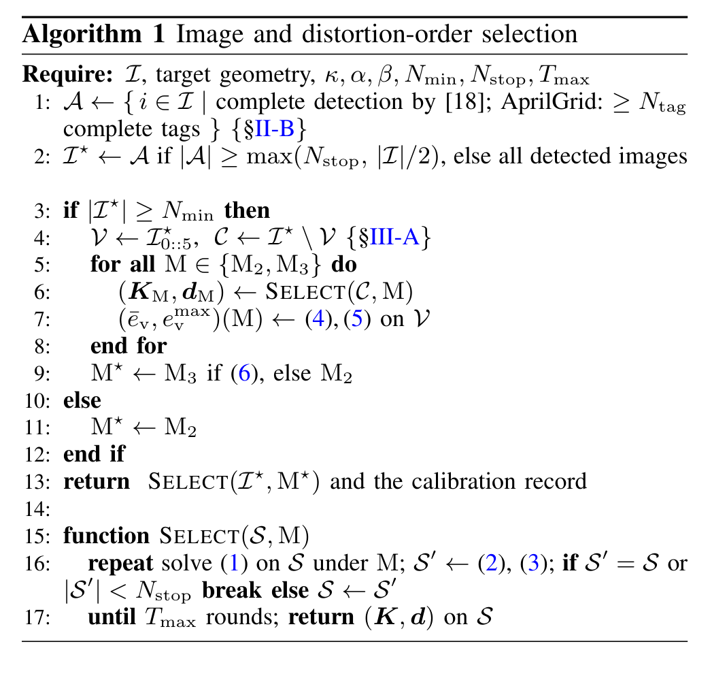 |
| ------------------------------------------------------------ | ------------------------------------------------------------ |

## 动态

- **2026/11**：论文被 IEEE Robotics and Automation Practice (RA-P) 接收。
- **2026/10/11**：发布标定工具、数据与实验脚本。
- **2026/09/09**：论文公开于 [arXiv](https://arxiv.org/abs/2609.10082)。

## 视频

<div align="center">

<a href="./README/intrinsic_calib_video.mp4">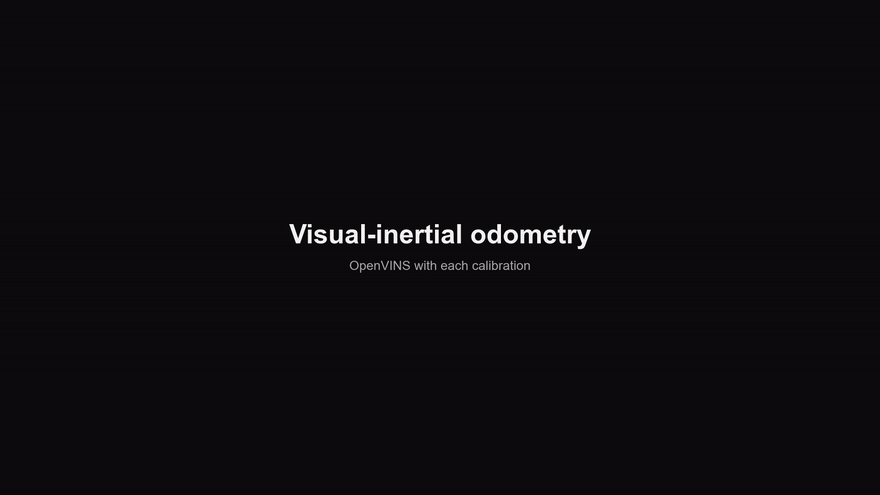</a>

</div>

点击图像播放完整视频（92 秒）。

## 方法

**图像选择。** Stage 1 仅接收提取器恢复出完整内角点网格的图像。Stage 2 迭代剔除平均残差超过中位数一定倍数的图像，并重新求解标定：

<div align="center">

$$
\tau^{(t)} = \kappa\,\tilde{e}^{(t)}, \qquad
\mathcal{I}^{(t+1)} = \lbrace\, i\in\mathcal{I}^{(t)} \mid \bar{e}_i^{(t)} \le \tau^{(t)} \,\rbrace
$$

</div>

**畸变阶数选择。** 接收的图像集被划分为估计子集与验证子集 $\mathcal{V}$。各候选阶数在内部执行 Stage 2 完成估计，并在 $\mathcal{V}$ 上仅重新估计标定板位姿。当且仅当平均误差与最差视图误差均未变差时，采用 $\mathrm{M}_3$（在 $\mathrm{M}_2$ 的基础上增加 $k_3$）：

<div align="center">

$$
\bar{e}_{\mathrm{v}}(\mathrm{M}_3) \le \alpha\,\bar{e}_{\mathrm{v}}(\mathrm{M}_2)
\quad\text{and}\quad
e^{\max}_{\mathrm{v}}(\mathrm{M}_3) \le \beta\,e^{\max}_{\mathrm{v}}(\mathrm{M}_2)
$$

</div>

所有超参数在全部数据集上保持固定：$\kappa=2$，$\alpha=\beta=1$，$N_{\min}=15$，$N_{\mathrm{stop}}=8$，$T_{\max}=3$。

**交互式工具。** 工具显示每幅图像的筛选状态与标定点分布，并记录每项决策。左：棋盘格数据（Rig-A，3 倍速播放）。右：AprilGrid 数据（Rig-C）。

| 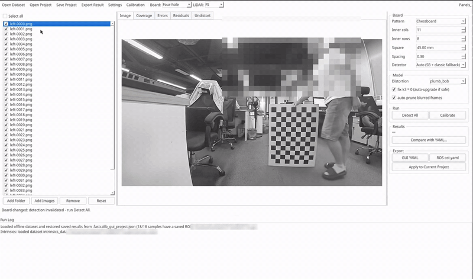 | 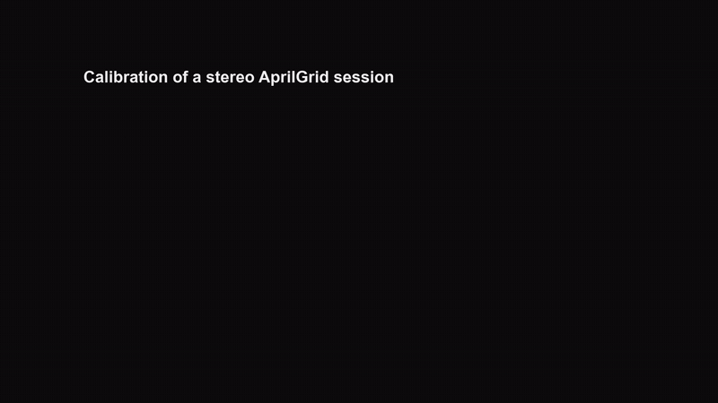 |
| ------------------------------------------------------------ | ------------------------------------------------------------ |

## 数据集

<div align="center">

| 数据集 | 相机 | 标定板 | 数据 |
| ------ | ---- | ------ | ---- |
| `Rig-A` | 1920 x 1080，111° | 棋盘格 11 x 8，45 mm | 39 幅图像 |
| `Rig-B` | 同型号的第二台相机 | 棋盘格 11 x 8，45 mm | 64 幅图像 |
| `Rig-C` | 手持双目 FLIR，1440 x 1080，113° | 3 x 3 AprilGrid | 标定会话 D1、D2；序列 S1、S2、S3 |
| `Rig-D` | 轮式机器人，Rig-A 同型号相机 | 棋盘格 11 x 8，45 mm | 一条 163 秒序列 |
| `Public` | OpenCalib、ROS、OpenCV | 棋盘格 | 五个会话 |

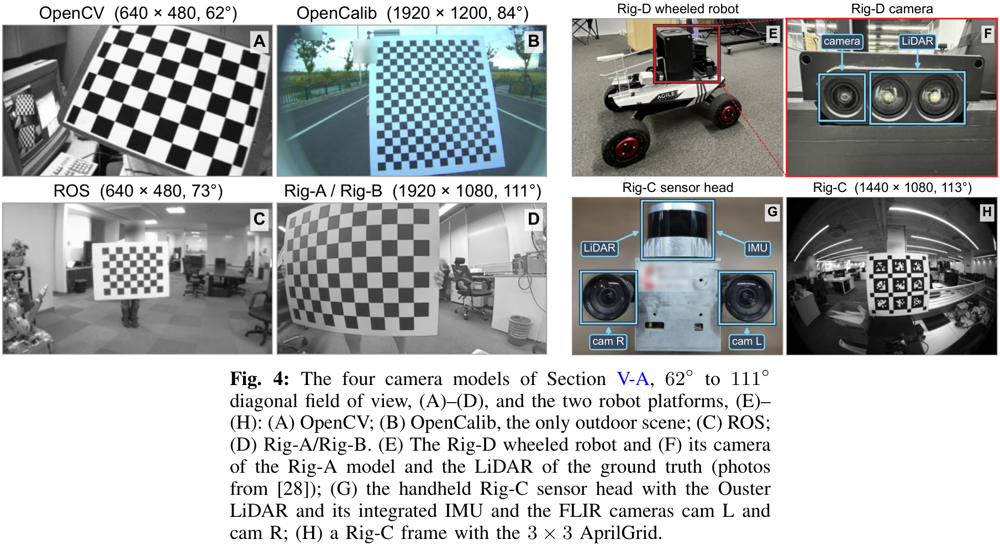

</div>

Rig-A 与 Rig-B 位于 `data/`。Rig-C 与 Rig-D 的 bag 可从[百度网盘](https://pan.baidu.com/s/1n3tDlzshlr6OiQmL6GJtyQ?pwd=vihg)下载（提取码 `vihg`），公开数据从其原始来源获取。[docs/DATA.md](./docs/DATA.md) 列出每项实验所用的数据。

## 结果

**图像选择与跨会话一致性。** 在 Rig-A 上，两个阶段将留出误差从 0.419 px 降至 0.316 px（25%）。在 Rig-C 上，本方法在两台相机上均将 Kalibr 的跨会话误差降低 36% 至 50%，两天之间焦距变化小于 1.5 px，而 Kalibr 约为 7 px。

| 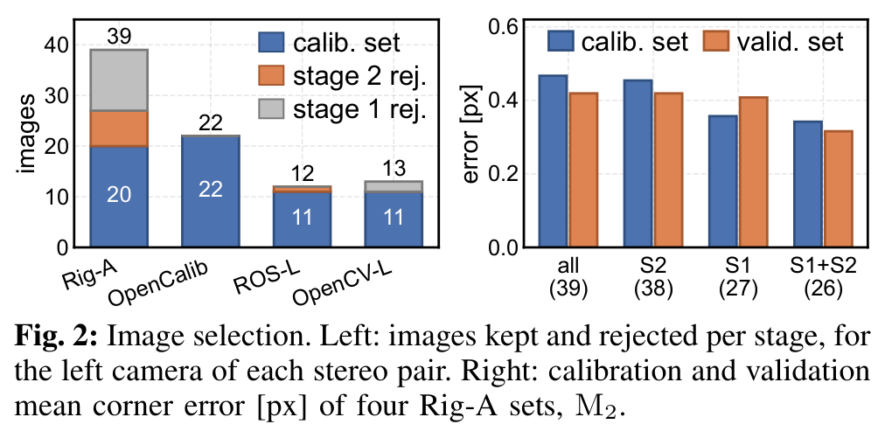 | 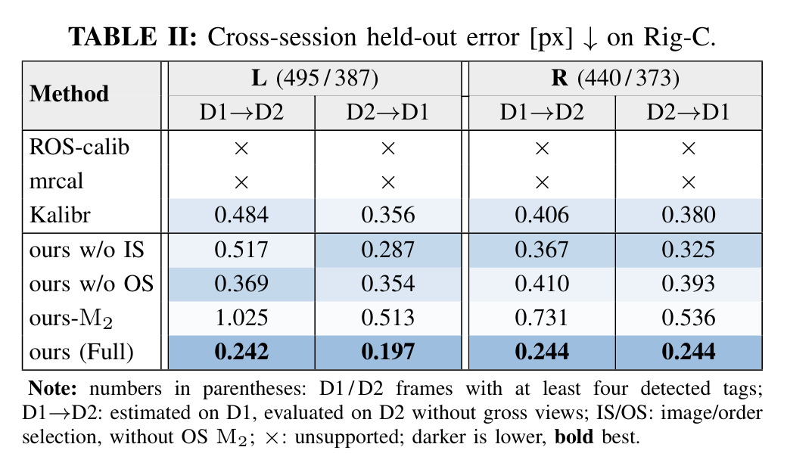 |
| ------------------------------------------------------------ | ------------------------------------------------------------ |

**阶数选择与消融对比。** 在 Rig-A 上，$\mathrm{M}_3$ 进一步将留出均值降至 0.299 px，并将最差视图误差从 0.590 px 降至 0.554 px。在 Rig-C 上，使用全部图像与 $\mathrm{M}_2$ 的基线（ours-$\mathrm{M}_2$）跨会话误差为 0.513 px 至 1.025 px，而完整流程为 0.197 px 至 0.244 px。

| 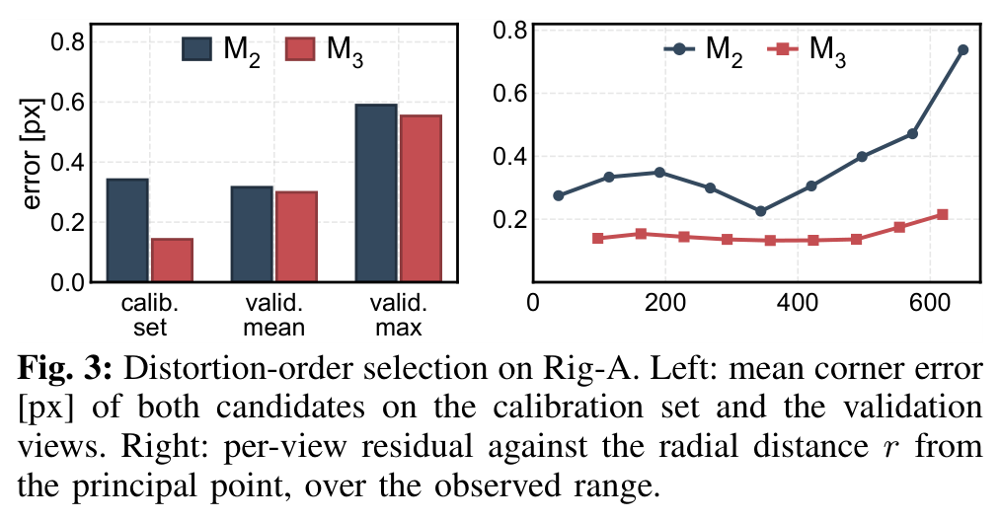 | 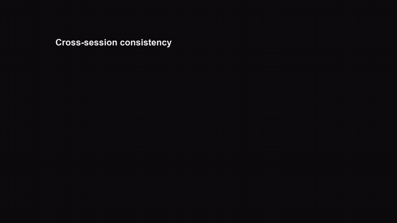 |
| ------------------------------------------------------------ | ------------------------------------------------------------ |

**公开数据与里程计。** 本方法在全部五个公开会话上取得最低的留出均值。使用 OpenVINS 时，本方法的内参在 Rig-C 的三条序列上均取得最低轨迹误差，并在 Rig-D 上取得最低的中位误差。

| 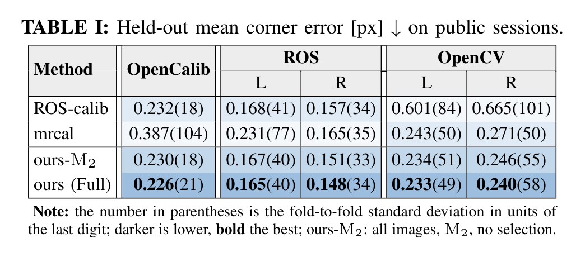 | 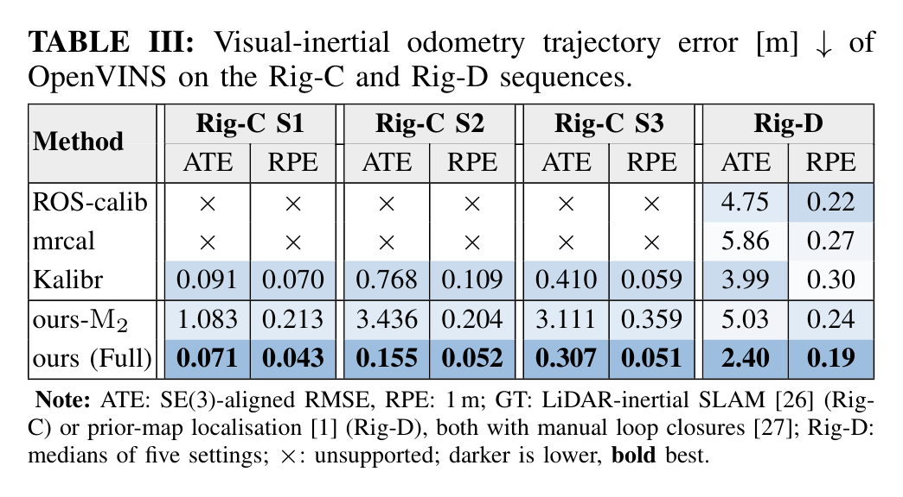 |
| ------------------------------------------------------------ | ------------------------------------------------------------ |

## 快速开始

实现基于 Python 3.10、OpenCV 4.13 与 PySide6，已在 Ubuntu 20.04 上测试。

```bash
git clone https://github.com/JokerJohn/IntrinsicCalib.git && cd IntrinsicCalib
conda create -n intrinsic_calib python=3.10 && conda activate intrinsic_calib
pip install -r requirements.txt
sudo apt install g++ pkg-config libopencv-dev libeigen3-dev   # Kalibr 提取器，首次使用时编译

python tool/run_intrinsics_gui.py data/rig_a                  # 交互式工具：先 Detect All，再 Calibrate
python experiments/public/experiment/rap_headless.py data/rig_a --out rig_a.json   # 无界面运行
```

无界面运行的结果为：检测 39 幅，Stage 1 后 27 幅，最终 20 幅，选择 $\mathrm{M}_3$，保留图像上的误差为 0.143 px。[docs/REPRODUCE.md](./docs/REPRODUCE.md)（英文）说明 Python 接口、复现论文各表格的命令与测试。

```
tool/          标定包 intrinsic_calib 与启动脚本
experiments/   public（Table I）、rigc（Table II）、vio（Table III）
data/          Rig-A、Rig-B、Rig-C 的 Kalibr 文件、bag 清单
tests/         Rig-A 选择、AprilGrid 提取与工具的测试
```

## 待办

- [x] 发布标定工具与实验脚本
- [x] 发布 Rig-A 至 Rig-D 数据
- [ ] 增加有理模型与鱼眼模型候选
- [ ] 增加覆盖度约束
- [ ] 支持卷帘快门相机与事件相机

## 引用

```bibtex
@article{hu2026intrinsiccalib,
  title         = {Automatic Reproducible Camera Intrinsic Calibration},
  author        = {Hu, Xiangcheng},
  journal       = {IEEE Robotics and Automation Practice},
  note          = {Accepted},
  eprint        = {2609.10082},
  archivePrefix = {arXiv},
  primaryClass  = {cs.RO},
  year          = {2026}
}
```

相关工作：[P²Calib](https://github.com/JokerJohn/P2Calib) 与 [VeriCalib](https://github.com/JokerJohn/VeriCalib)。

## 致谢

工具使用了 [OpenCV](https://github.com/opencv/opencv) 与 [Kalibr](https://github.com/ethz-asl/kalibr) 的 `ethz_apriltag2` 解码器。评估使用了 [OpenCalib](https://github.com/PJLab-ADG/SensorsCalibration)、[ROS camera_calibration](http://wiki.ros.org/camera_calibration)、[mrcal](https://mrcal.secretsauce.net) 与 Kalibr 的数据和基线。里程计实验与真值使用了 [OpenVINS](https://github.com/rpng/open_vins)、[evo](https://github.com/MichaelGrupp/evo)、[FAST-LIO2](https://github.com/hku-mars/FAST_LIO)、[PALoc](https://github.com/JokerJohn/PALoc) 与 [Manual Loop Closure Tools](https://github.com/JokerJohn/Mannual-Loop-Closure-Tools)。

## 许可证

本项目基于 [MIT 许可证](./LICENSE)发布。`tool/intrinsic_calib/kalibr_extractor/third_party/` 包含 `ethz_apriltag2` 源码与 Kalibr 的标定板提取代码（BSD，[KALIBR_LICENSE](tool/intrinsic_calib/kalibr_extractor/third_party/KALIBR_LICENSE)）。公开数据沿用其来源的许可证。

## 贡献者

<a href="https://github.com/JokerJohn/IntrinsicCalib/graphs/contributors">
  
</a>
